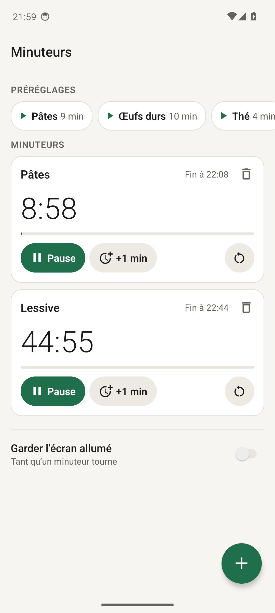
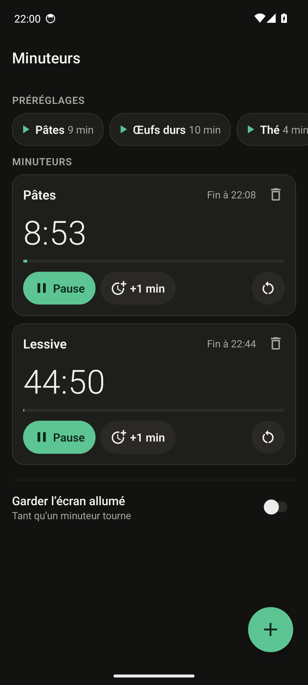
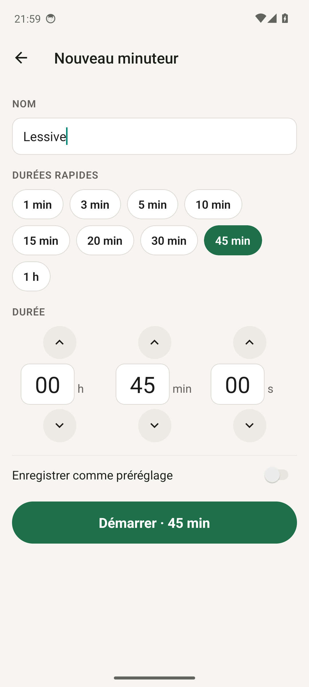
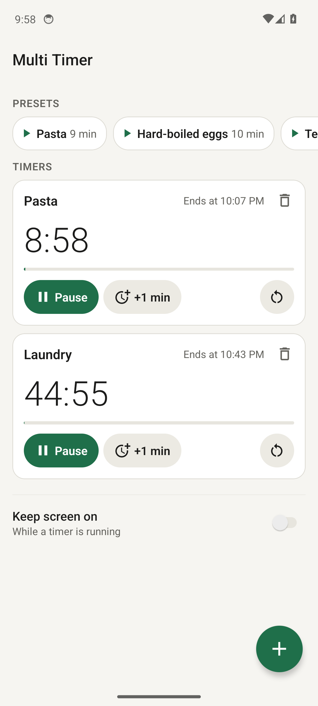

# Minuteurs (Multi Timer)

[English](README.md)

Une petite app Android pour lancer plusieurs minuteurs nommés en même temps : cuisine, lessive, sport. Chaque minuteur reste visible avec son propre décompte, et vous êtes prévenu à la fin, même si l’app est en arrière-plan ou fermée.

Open source (MIT), hors ligne, sans compte, sans publicité, sans traceur.

## Captures

Vraies captures d’un émulateur Android 14 (1080 x 2400), prises par la CI avec `scripts/android-screenshots.sh`. Les minuteurs ont été créés depuis l’interface de l’app.

| Minuteurs | Thème sombre | Nouveau minuteur | Anglais |
| --- | --- | --- | --- |
|  |  |  |  |

Toutes les captures dans [docs/screenshots/android](docs/screenshots/android) (français et anglais).

## Fonctionnalités

- Plusieurs minuteurs en parallèle, triés par temps restant (les minuteurs terminés en haut).
- Créer un minuteur avec un nom et une durée : durées rapides (1 min à 1 h) ou sélecteur heures / minutes / secondes.
- Démarrer, mettre en pause, reprendre, +1 min, réinitialiser, supprimer.
- Chaque minuteur garde son heure de fin exacte, pas un compteur : il reste juste après un passage en arrière-plan, une fermeture de l’app ou un redémarrage du téléphone.
- À la fin d’un minuteur : notification locale à l’heure exacte (canal prioritaire avec son et vibration), plus une alerte et une vibration dans l’app si elle est ouverte.
- Préréglages enregistrés (par exemple « Pâtes 9 min ») pour relancer en un geste. Appui long pour supprimer un préréglage.
- Widget d’écran d’accueil (Android) : les minuteurs en cours avec leur heure de fin (par exemple « Pâtes — fin à 18:42 ») et un bouton pour ouvrir l’app. Clair et sombre.
- Option « Garder l’écran allumé » tant qu’un minuteur tourne.
- Français et anglais, selon la langue du téléphone. Thème clair et sombre.

## Confidentialité

Aucune donnée ne quitte le téléphone. Minuteurs, préréglages et réglages sont enregistrés sur l’appareil uniquement (SQLite). Pas de compte, pas de mesure d’audience, aucun appel réseau. Voir [PRIVACY.md](PRIVACY.md).

Autorisations Android : notifications, vibration, alarmes exactes (pour que la notification arrive à l’heure) et lancement au démarrage (pour que les notifications prévues survivent à un redémarrage). Le paquet déclare aussi l’autorisation Internet ajoutée par défaut par React Native ; l’app elle-même ne fait aucun appel réseau.

## Compiler

Prérequis : Node.js 22, JDK 17 et le SDK Android.

```bash
npm ci
npm run typecheck && npm run lint && npm test
npx expo prebuild --platform android
cd android && ./gradlew assembleRelease
```

L’APK est dans `android/app/build/outputs/apk/release/`. Il est signé avec la clé de débogage du modèle : suffisant pour tester, pas pour le Play Store.

La CI (`.github/workflows/android.yml`) lance les vérifications, compile l’APK, fait des captures sur un émulateur Android 14 en anglais et en français (échec si l’app plante ou si un préréglage ne lance pas de minuteur), et joint l’APK à une release GitHub pour les tags `v*`.

Pile : Expo SDK 58, React Native, TypeScript, Expo Router, expo-sqlite, expo-notifications. La logique des minuteurs est dans `src/lib/`, avec des tests Jest.

iOS n’est pas testé.

## Licence

[MIT](LICENSE) © 2026 Firas Hmedi
