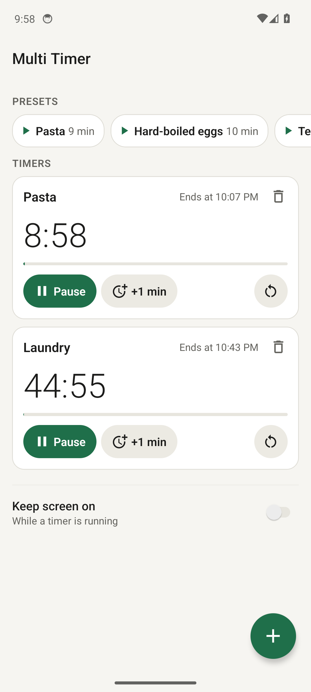
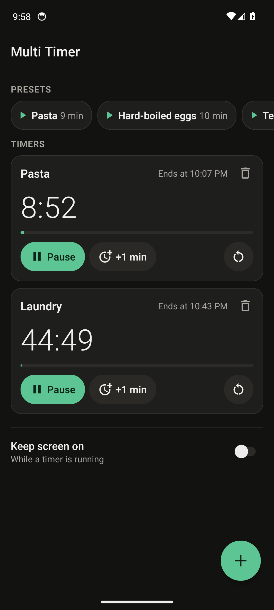
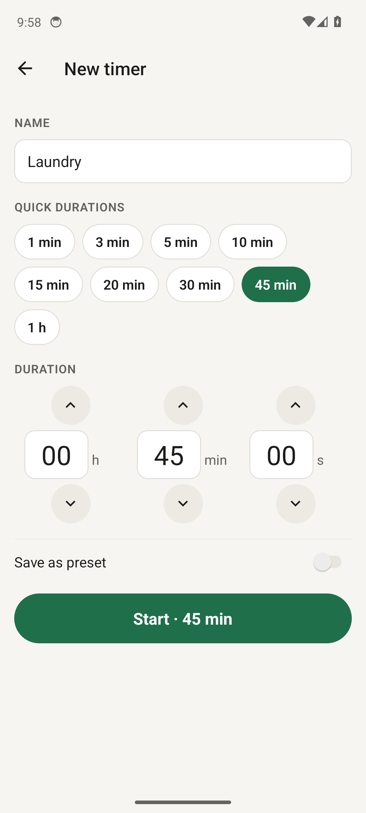
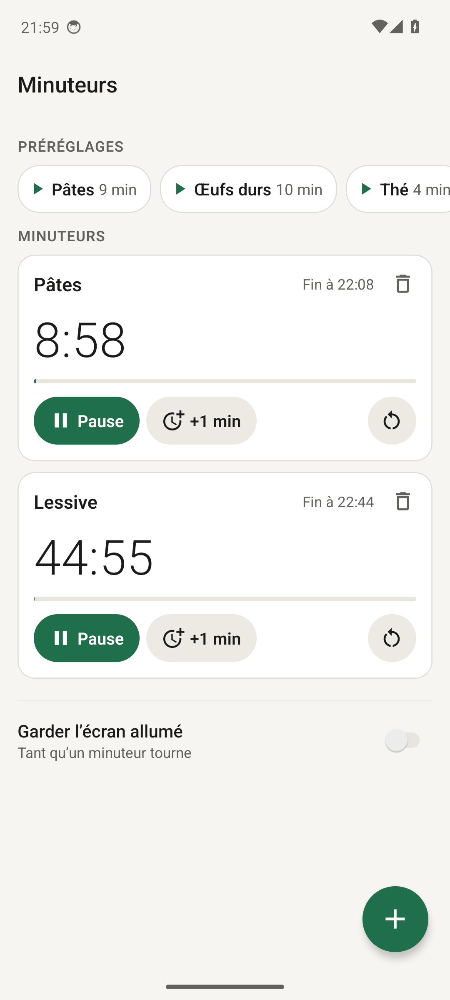

# Multi Timer (Minuteurs)

[Français](README.fr.md)

A small Android app to run several named timers at once: cooking, laundry, workouts. Each timer stays visible with its own countdown, and you are alerted when it ends, even if the app is in the background or closed.

Open source (MIT), offline, no account, no ads, no tracking.

## Screenshots

Real screenshots from an Android 14 emulator (1080 x 2400), taken by CI with `scripts/android-screenshots.sh`. The timers were created through the app's interface.

| Timers | Dark theme | New timer | French |
| --- | --- | --- | --- |
|  |  |  |  |

More in [docs/screenshots/android](docs/screenshots/android) (English and French).

## Features

- Several timers running in parallel, sorted by time remaining (finished timers on top).
- Create a timer with a name and a duration: quick durations (1 min to 1 h) or an hours / minutes / seconds picker.
- Start, pause, resume, +1 min, reset, delete.
- Timers are stored as absolute end times, not as a ticking counter, so they stay correct after the app was in the background, killed or the phone restarted.
- When a timer ends: a local notification at the exact end time (high-priority channel with sound and vibration), plus an in-app alert and vibration if the app is open.
- Saved presets (for example "Pasta 9 min") to start a timer in one tap. Long press a preset to delete it.
- Optional "Keep screen on" while a timer is running.
- French and English, following the phone language. Light and dark theme.

## Privacy

No data leaves the phone. Timers, presets and settings are stored on the device only (SQLite). No account, no analytics, no network calls. See [PRIVACY.md](PRIVACY.md).

Android permissions: notifications, vibration, exact alarms (so the end notification is on time) and "run at startup" (so scheduled notifications survive a reboot). The build also declares the Internet permission that React Native adds by default; the app itself makes no network calls.

## Build locally

Requirements: Node.js 22, JDK 17 and the Android SDK.

```bash
npm ci
npm run typecheck && npm run lint && npm test
npx expo prebuild --platform android
cd android && ./gradlew assembleRelease
```

The APK is in `android/app/build/outputs/apk/release/`. It is signed with the debug key of the template: fine for testing, not for the Play Store.

CI (`.github/workflows/android.yml`) runs the checks, builds the APK, takes screenshots on an Android 14 emulator in English and French (failing if the app crashes or a preset does not start a timer), and attaches the APK to a GitHub release for `v*` tags.

Stack: Expo SDK 58, React Native, TypeScript, Expo Router, expo-sqlite, expo-notifications. The timer logic is in `src/lib/` with Jest tests.

iOS is not tested.

## License

[MIT](LICENSE) © 2026 Firas Hmedi
